<div align="center">

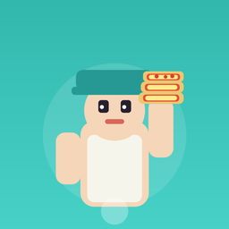

# Pizza Empire

**A mobile arcade-idle restaurant game built with Unity 6.**

Bake, carry, serve, collect cash, and grow a tiny pizza shop into an endless food empire.


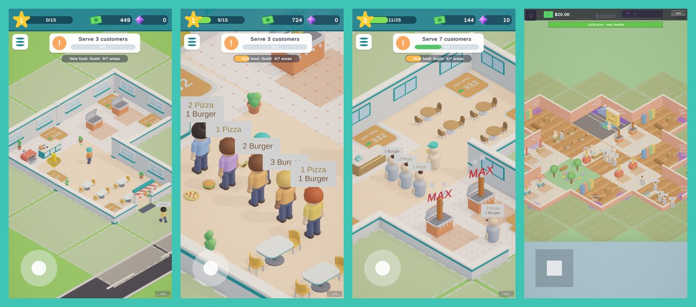

</div>

---

## Table of contents

- [About](#about)
- [Screenshots](#screenshots)
- [How to play](#how-to-play)
- [Gameplay loop](#gameplay-loop)
- [Features](#features)
- [Progression and economy](#progression-and-economy)
- [Architecture](#architecture)
- [Project structure](#project-structure)
- [Getting started](#getting-started)
- [Development history](#development-history)

## About

Pizza Empire is an original arcade-idle game for portrait mobile screens. You run around a
restaurant picking up food from ovens, serving the customers who queue at the counter, and
scooping up the cash they leave behind. You spend that cash on glowing floor pads that unlock
new areas, stations, tables and staff, until the restaurant runs itself and keeps growing across
an endless map of plots.

The game's art, characters, food and props are all made for this project.

<div align="center">
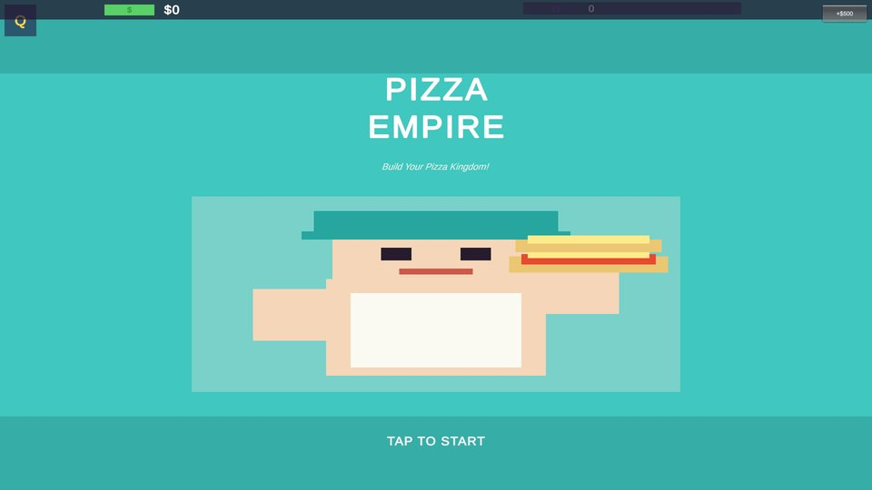
</div>

## Screenshots

| Restaurant | Rush at the counter | Kitchen stations |
|:---:|:---:|:---:|
| 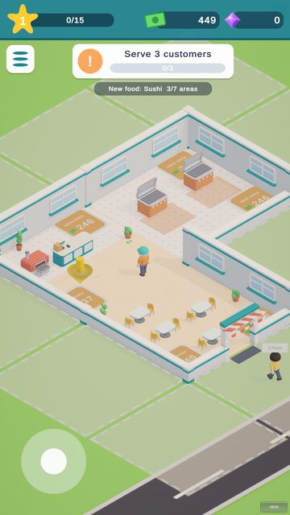 | 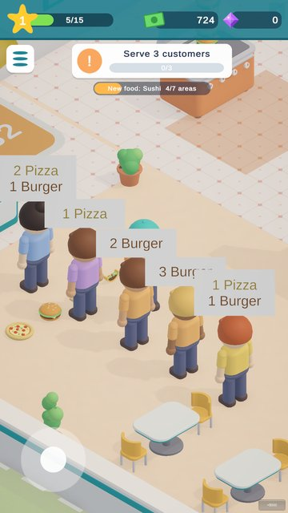 | 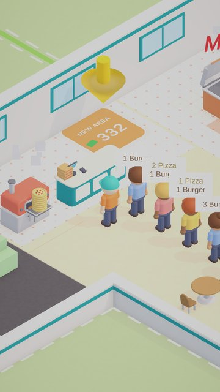 |
| **Dine-in area** | **Stations at MAX** | **Endless plot map** |
| 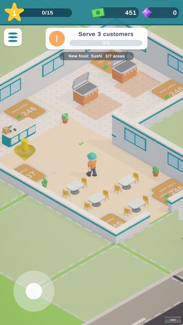 | 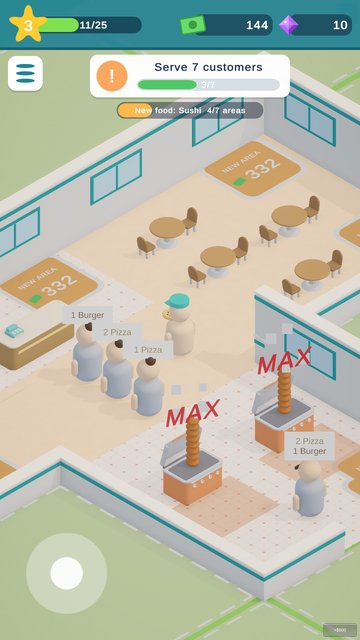 | 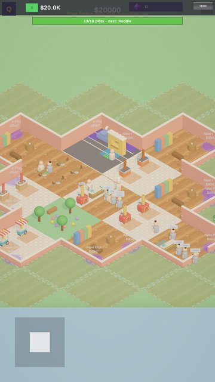 |
| **Guided tutorial** | **Unlocking a new area** | **Impatient customer** |
| 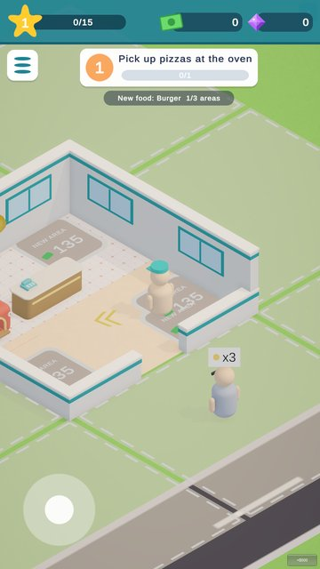 | 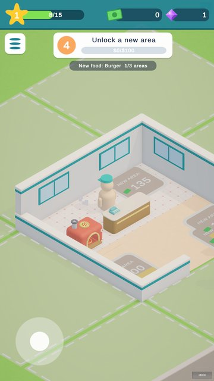 | 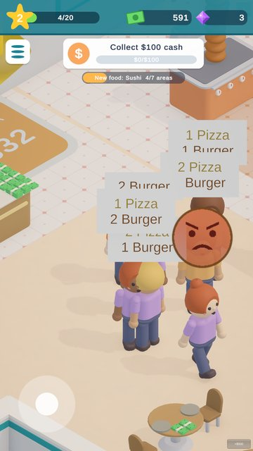 |

## How to play

| Action | Mobile | Editor |
|---|---|---|
| Move | Virtual joystick (drag anywhere) | WASD / arrow keys |
| Pick up food | Walk into an oven's pickup spot | Same |
| Serve customers | Walk to the counter while carrying food | Same |
| Collect cash | Walk over the cash piles | Same |
| Buy upgrades / areas | Stand on a floor buy pad until it's paid | Same |

## Gameplay loop

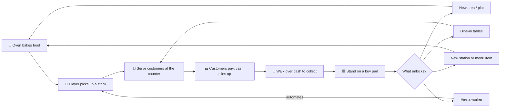

Customers order a mix of the menu (for example "2 Pizza, 1 Burger"). They queue at the counter
or sit at dine-in tables, and as the shop grows a drive-thru lane brings in cars that pay extra.

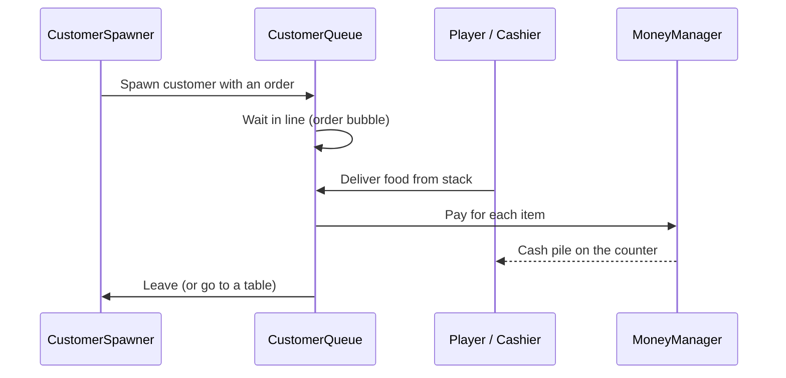

## Features

**Core arcade-idle loop**
- Visible food stacks carried by the player and workers
- Stand-to-pay floor pads that drain money tick by tick and remember partial payments
- Cash that flies, piles up and pops when collected

**An endless restaurant**
- The map is a grid of 8 × 8 m plots. Each new plot is rolled from a weighted table: a
  kitchen station, a counter, dining, a staff room or decor
- Walls rebuild around the owned area, and the NavMesh is re-baked after every purchase
- An endless menu: Pizza, Burger, Sushi and Taco, then procedurally generated foods that
  are worth more

**Staff and automation**
- 👨‍🍳 **Chef** carries food from stations to counters
- 🧑‍💼 **Cashier** serves customers at a counter
- 🧹 **Cleaner** clears and cleans dine-in tables
- 🚗 **Drive-thru worker** serves cars in the drive-thru lane

**Engagement systems**
- ⭐ Restaurant level and XP (+1 per customer served, +5 per plot bought)
- 💎 Gems from level-ups, objectives and daily quests
- 🎯 Endlessly scaling objectives: serve → collect → unlock
- 📅 Three daily quests that reset at local midnight
- 🔥 **Rush Hour** every 4 minutes: customers come twice as fast and pay double for 45 seconds
- 🌆 **Prestige ("New City")**: restart with a permanent +50% income multiplier
- 💤 Offline earnings (up to 2 hours) based on the workers you've hired
- 💾 JSON auto-save every 10 seconds

**Polish**
- A first-time guided tutorial with a guide arrow and floor pointer
- A HUD with level, cash, gems and an objective card
- Juice: floating text, pop bubbles, "MAX" tags on full stations, sound effects
- A bright toy-shop art style with custom-modelled characters, props and food (glTF)

## Progression and economy

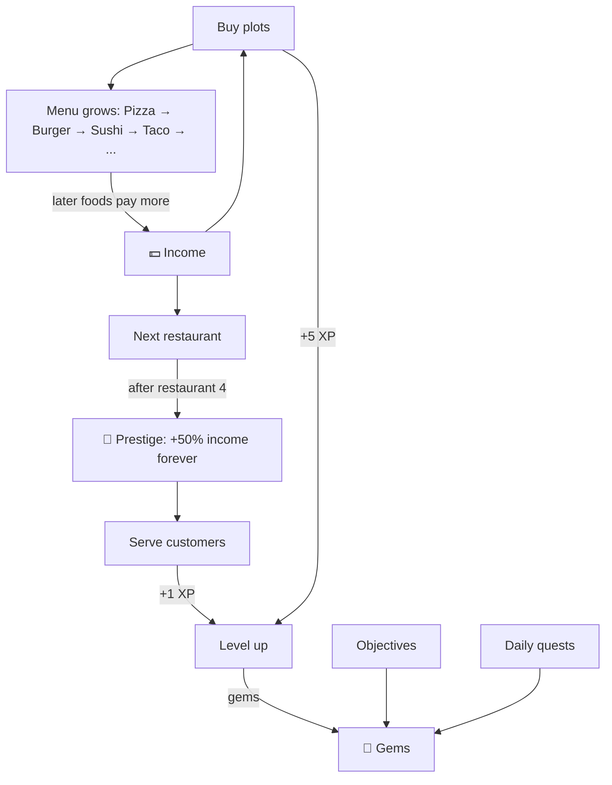

| Rule | Value |
|---|---|
| Level n requires | `10 + 5n` XP |
| Next plot price | `BasePrice × 1.35^plotsOwned` |
| Rush Hour | Every 240 s, lasts 45 s, 2× spawn rate and 2× pay |
| Drive-thru payout | 1.5× the menu average |
| Offline earnings cap | 2 hours |
| Prestige bonus | +50% income per prestige |

## Architecture

The game is mostly built from code at runtime: builders and factories create the world, UI and
props, so the scene stays small. Systems talk to each other through `GameEvents` rather than
direct references where possible.

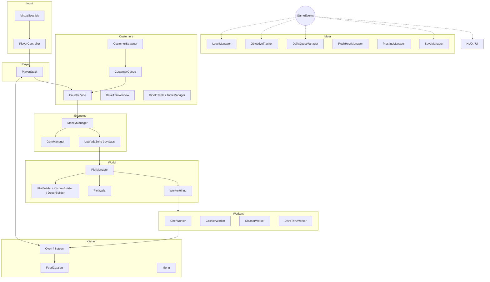

## Project structure

```
Assets/
├── Branding/        App icon
├── Editor/          Editor tools (app icon generator, …)
├── Materials/       URP materials
├── Models/          glTF models: ovens, counters, food, furniture, characters, walls
├── Resources/       Runtime-loaded assets
├── Scenes/          SampleScene.unity (main scene)
└── Scripts/
    ├── CameraSystem/  CameraFollow: 45° follow camera
    ├── Core/          Managers (level, gems, quests, rush hour, prestige, tutorial),
    │                  restaurant config, palettes, visual factories, audio, juice
    ├── Customers/     Spawner, queue, counter zone, order bubbles
    ├── DriveThru/     Drive-thru lane and cars
    ├── Kitchen/       Food catalog, menu, ovens/stations, food items
    ├── Money/         Money manager, cash piles, pickups, fly-to-HUD effects
    ├── Player/        Player controller and carried stack
    ├── Plots/         Endless plot grid, builders, walls, worker hiring
    ├── Save/          GameData, SaveManager, offline earnings UI
    ├── Tables/        Dine-in tables and table manager
    ├── UI/            HUD, joystick, title screen, objective card, UI factories
    ├── Upgrades/      Buy pads, guide arrow
    └── Workers/       Chef, cashier, cleaner, drive-thru workers
```

84 C# scripts, about 10k lines.

## Getting started

### Requirements
- **Unity 6000.3.10f1** (Unity 6) with iOS and/or Android build support
- Packages (resolved automatically from `Packages/manifest.json`): URP 17.3, Input System 1.18,
  AI Navigation 2.0, glTFast 6.21

### Run it
1. Clone the repo:
   ```bash
   git clone https://github.com/omar-abidi-dev/pizza-empire-idle-restaurant-game.git
   ```
2. Open the folder in Unity Hub with **Unity 6000.3.10f1**. The first import builds the
   `Library/` folder, which takes a few minutes.
3. Open `Assets/Scenes/SampleScene.unity` and press **Play**. Set the Game view to a portrait
   resolution such as 1080 × 1920.

### Build for mobile
**File → Build Profiles**, choose iOS or Android, then **Build**. The app is set up as
*Pizza Empire* by *Omar Games*, portrait only.

## Development history

The game was built in clear phases, each committed separately:

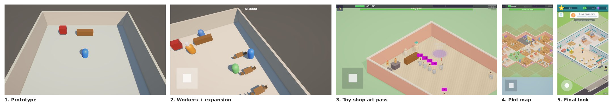

| Phase | What was added |
|---|---|
| Steps 1–4 | Movement and camera, oven and carrying, customers and counter, money |
| Steps 5–8 | Upgrade zones, chef worker, dine-in tables, expansion and drive-thru |
| Steps 9–12 | Save and offline earnings, juice and sound, multiple restaurants, endless progression and daily engagement |
| Steps 13–14 | Toy-shop visual overhaul, Pizza Empire branding (title screen and app icon) |
| Models | Counter, table, chair, trash bin, drive-thru booth, cash, pizza, burger grill, sushi counter, taco cart |
| Visual A–C5 | Camera and scale, endless plot map, bright world and buy pads, feedback, HUD, guided tutorial |
| Final art | Modelled toy characters, kitchen, dining, food and cash props, walls with windows and an awning |

Other branches keep earlier milestones: `prop-models`, `fix-console-gltfast` and `visual-c-world-look`.

---

<div align="center">
Made with ☕ and 🍕 by <a href="https://github.com/omar-abidi-dev">Omar Abidi</a>
</div>
